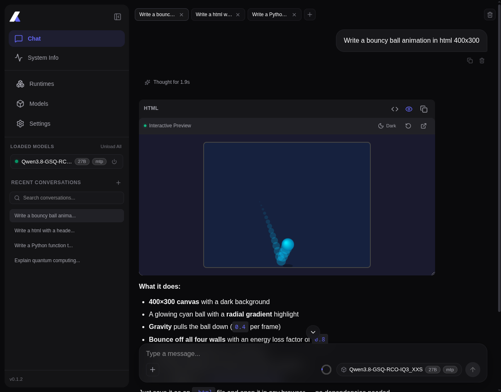
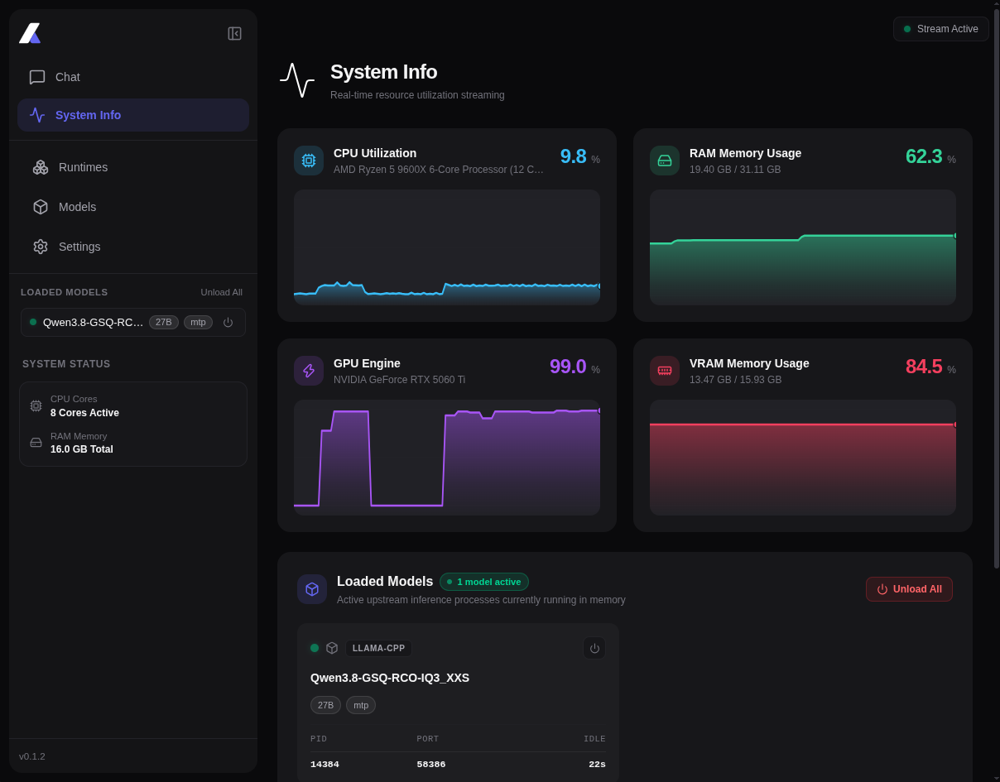
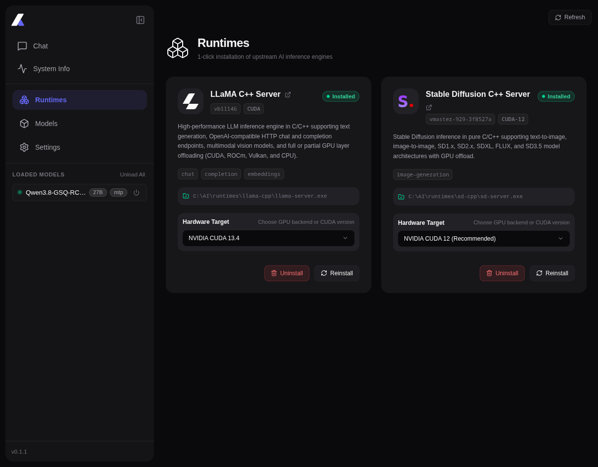
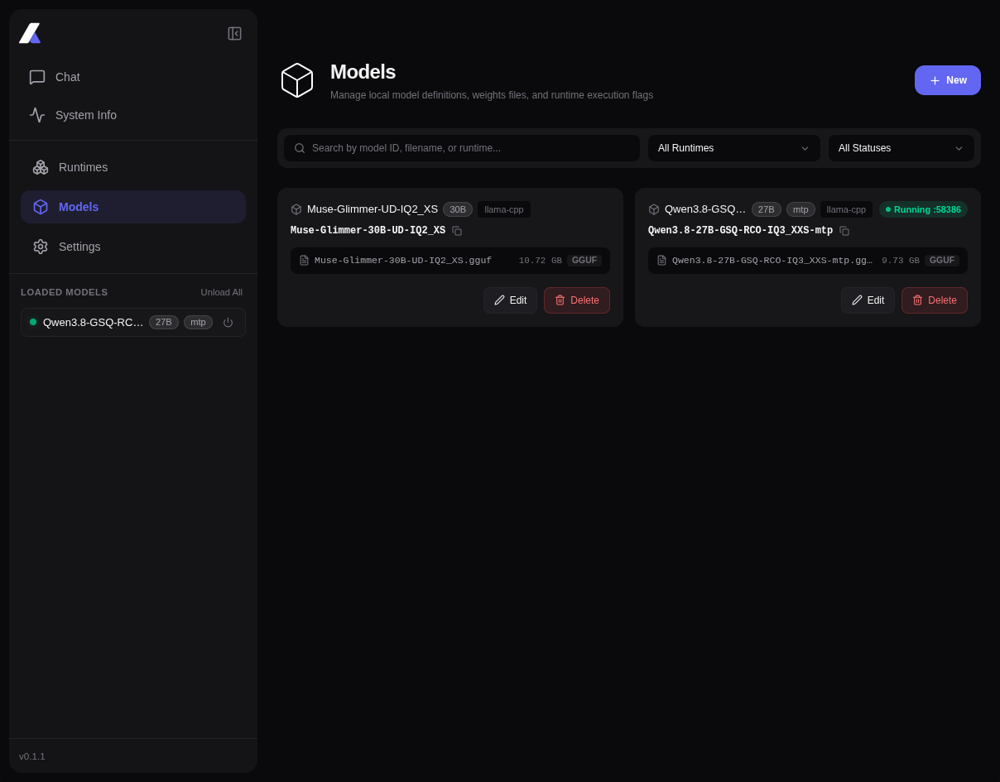
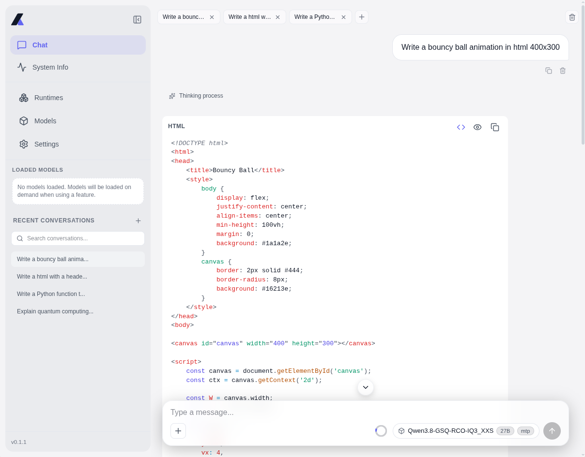
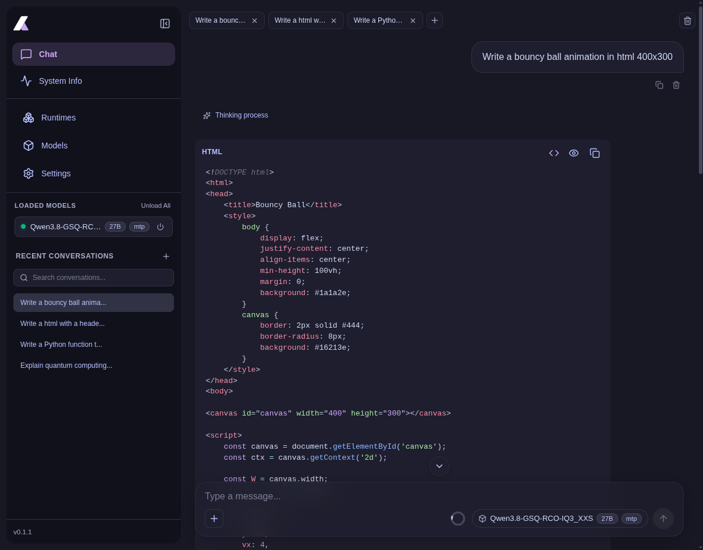
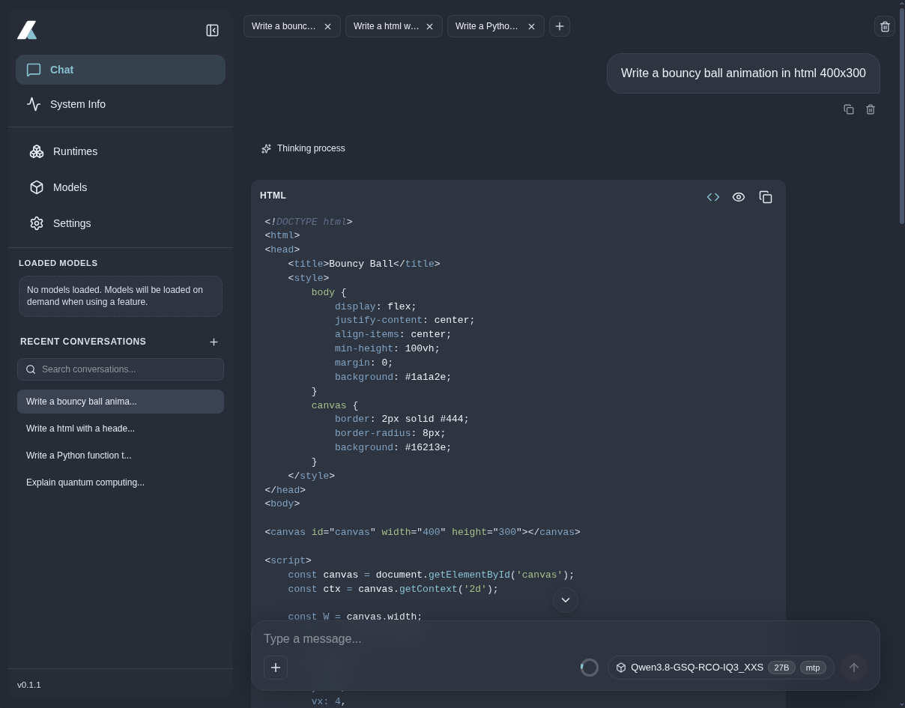
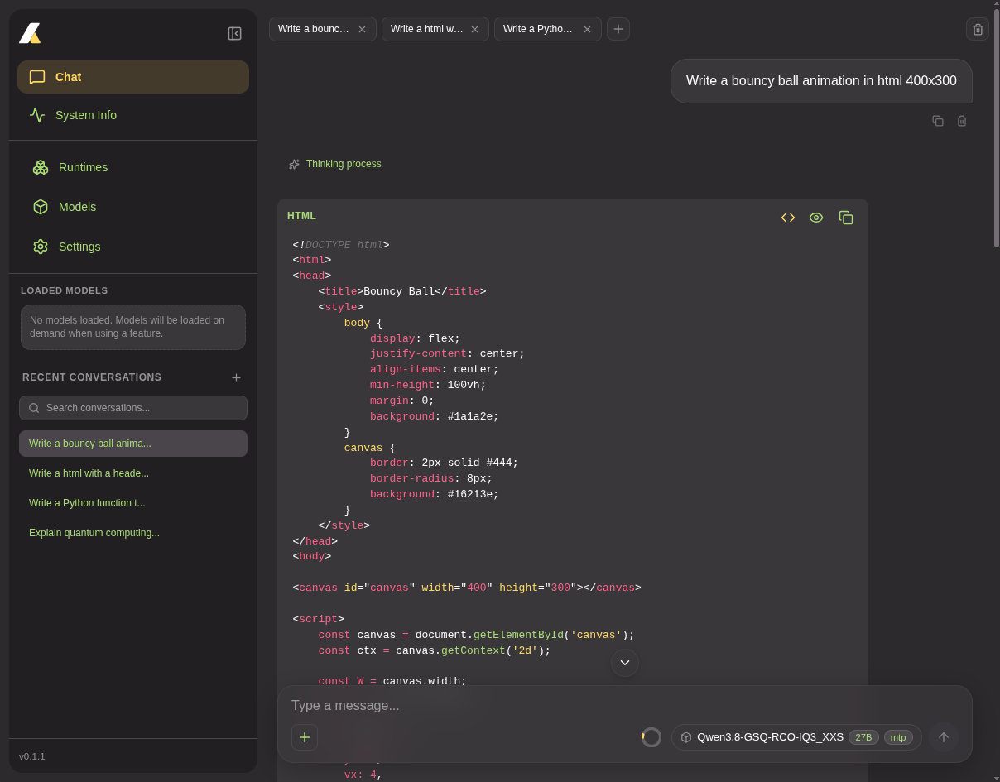

<div align="center">
  

**Monolai**

**A lightweight, local AI model manager and OpenAI-compatible runtime.**

[](https://github.com/odevsa/monolai/releases/latest)


[Features](#features) •
[Themes](#themes) •
[Installation](#installation) •
[Getting Started](#getting-started) •
[CLI](#cli) •
[Docker](#docker) •
[Configuration](#configuration) •
[API Usage](#api-usage) •
[Development](#development) •
[Tech Stack](#tech-stack)

</div>

## Overview

<div align="center">
  
  
  <br />
  
  
</div>

**Monolai** is a **local AI model manager** and **OpenAI-compatible runtime**. It is a **lightweight**, **offline** and **private** tool that allows you to **run local models** (GGUF) on your own hardware with **zero telemetry**.

## Features

- **Offline & Private**: Run local models (GGUF / diffusion checkpoints) on your own hardware with zero telemetry.
- **Hardware Acceleration**: Automatic GPU detection and support for **CUDA**, **ROCm**, and **Vulkan**, with multi-threaded CPU fallback.
- **Automated Runtime Management**: Automatic download, version tracking, and installation of upstream engine binaries (`llama.cpp`, `stable-diffusion.cpp`).
- **Image Generation**: Local text-to-image generation powered by `stable-diffusion.cpp` with support for custom resolutions, negative prompts, CFG scale, sampling steps, and seeds.
- **Reasoning & Thinking Process**: Real-time streaming support for reasoning models (e.g., DeepSeek-R1) with dedicated expandable `<think>` UI blocks in the chat view.
- **Memory & Process Lifecycle**: Automatic model unloading from VRAM/RAM after inactivity (`idle_timeout_seconds`) and orphan process cleanup.
- **OpenAI-Compatible API**: Drop-in `/v1/chat/completions`, `/v1/images/generations`, `/v1/embeddings`, and `/v1/models` endpoints compatible with standard SDKs and tools (OpenAI SDK, LangChain, Cursor, Continue).
- **Web UI**: Modern SvelteKit 5 dashboard with real-time hardware telemetry (CPU, RAM, GPU/VRAM, disk storage) via SSE, persistent chat history, and image gallery.
- **Log Management**: Built-in backend service logging and live frontend log viewer with service filtering, streaming, export, and diagnostics.
- **Internationalization (i18n)**: Out-of-the-box multi-language support for **9 languages**: English, Spanish (`es`), Portuguese (`pt-BR`), German (`de`), French (`fr`), Italian (`it`), Japanese (`ja`), Russian (`ru`), and Simplified Chinese (`zh-CN`).
- **Native Desktop GUI**: Cross-platform desktop app (`monolai-gui`) built with egui 0.30, single-instance enforcement, system tray, and background daemon supervisor.
- **OpenAPI Documentation**: Interactive Swagger UI at `/api/swagger`.
- **Multi-platform**: Linux, macOS, Windows, and Docker.

## Themes

Monolai includes **11 curated themes** tailored for different aesthetics and environments (`dark`, `light`, `catppuccin`, `code`, `dracula`, `nord`, `tokyonight`, `monokai`, `cyberpunk`, `emerald`, and `sunset`):

<div align="center">
  
  
  <br /><br />
  
  
</div>

## Installation

You can download pre-compiled release packages from the [Latest GitHub Releases](https://github.com/odevsa/monolai/releases/latest).

### Platform Packages

| Platform    | Packages / Formats             | Details                                                   |
| :---------- | :----------------------------- | :-------------------------------------------------------- |
| **Linux**   | `.deb`, `.AppImage`, `.tar.xz` | Pre-built binaries for `x86_64` and `aarch64`             |
| **Windows** | `.exe`                         | Pre-built Installer for `x86_64` and `aarch64`            |
| **macOS**   | `.dmg`                         | Apple Silicon (`arm64`) and Intel (`x86_64`) bundles      |
| **Docker**  | `odevsa/monolai:latest`        | Multi-arch container image with CUDA acceleration support |

> [!TIP]
> Each desktop release archive contains both the standalone server daemon (`monolai`) and the native desktop application with system tray management (`monolai-gui`).

---

## Getting Started

Follow these steps to set up Monolai and start running models in minutes:

### 1. Launch Monolai & Complete Setup

Start Monolai using the desktop app or the standalone server:

```bash
# Start backend server (or run monolai-gui)
monolai
```

Open your browser at **http://localhost:8080** (or open the desktop app).
On first launch, the configuration wizard guides you through:

- **Models Folder**: The local path where your model weights are saved
  - linux/macOS (default): `~/.local/share/monolai/models`
  - windows (default): `%LOCALAPPDATA%\monolai\models`
- **Runtimes Folder**: Where engine binaries will be installed
  - Linux / macOS (default): `~/.local/share/monolai/runtimes`
  - Windows (default): `%LOCALAPPDATA%\monolai\runtimes`
- **Network Configuration**: Bind host (e.g. `0.0.0.0`) and HTTP port (default: `8080`).

Hardware acceleration (CUDA, ROCm, Vulkan, Metal, CPU) is auto-detected and recommend the best option for your hardware on the **Runtimes** page, but you can always choose another option.

### 2. Install Inference Runtimes

Monolai uses modular inference engines that can be installed directly from the web UI:

1. Navigate to the **Runtimes** page (http://localhost:8080/runtimes).
2. Install the runtimes matching your use cases:
   - **`llama.cpp`**: Required for text generation, chat completion, and reasoning LLMs (`.gguf`).
   - **`stable-diffusion.cpp`**: Required for local text-to-image diffusion generation (`.safetensors`, `.bin`, etc).
3. Select your preferred acceleration backend (e.g. CUDA, Vulkan, or CPU) and click **Install**. Download and installation progress is streamed in real time.

### 3. Download Models

Download your favorite models (`.gguf`, `.safetensors`, `.bin`, etc) and place them directly into your configured models folder from [1. Launch Monolai & Complete Setup](#1-launch-monolai--complete-setup).

#### Some Places to Find and Download Models:

- **[Hugging Face](https://huggingface.co/models?pipeline_tag=text-generation&sort=trending)**: Popular place for downloading models

> [!TIP]
> **Quantization**: For the best trade-off between memory and speed, look for **`Q4_K_M`** quantizations or test other quantizations to find what works best for your hardware.

> [!TIP]
> **Mixture of Experts (MoE)**: Model with massive knowledge capacity and fast response times and low computational costs.

> [!TIP]
> **Multi-Token Prediction (MTP)**: Drastically speed up text or code generation, as the model predicts multiple tokens simultaneously instead of one by one.

### 4. Register & Manage Models

1. Go to the **Models** page (http://localhost:8080/models).
2. Click **Register Model** to create a model for inference.
3. Set model parameters such as:
   - **Model ID** (e.g., `qwen2.5-7b` or `deepseek-r1-7b`)
   - **Runtime Engine** (e.g., `Llama C++ Server`, `Stable Diffusion C++ Server`...)
   - **Flags** (e.g., `--model`, `--ctx-size`, `--gpu-layers`...)

### 5. Start Using Monolai

- **Chat**: Chat with your local models, featuring full markdown rendering and live streaming.
- **Image**: Create images locally with prompt tuning, negative prompts, aspect ratio presets, seeds, and generation history.
- **OpenAI Compatibility**: Use Monolai as a local replacement for OpenAI in **Zed**, **OpenCode**, **Continue**, **Open WebUI**, or any standard OpenAI Compatible client by setting the base URL to `http://localhost:8080/v1`.
- **Monitoring**: Check real-time GPU/VRAM, CPU, and RAM consumption under **System Info** and monitor live activity in **Logs**.

## CLI

```text
Usage: monolai [OPTIONS] [COMMAND]

Commands:
  config  Manage configuration file
  help    Print this message or the help of the given subcommand(s)

Options:
  -c, --config <CONFIG>             Path to config YAML file (-c or --config)
      --models <MODELS_FOLDER>      Path to models folder
  -l, --listen <LISTEN>             Listen address (e.g. 0.0.0.0:8080)
      --host <HOST>                 Host address to bind
  -p, --port <PORT>                 Port to bind
      --db <DB>                     Path to SQLite database
      --runtimes <RUNTIMES_FOLDER>  Path to extra runtime manifests folder
      --clean-storage               Clean storage: delete SQLite database and active process cache
      --factory-reset               Factory reset: delete database, process cache, and configuration
  -h, --help                        Print help
  -V, --version                     Print version
```

### CLI Configuration Commands (`config`)

Manage and inspect Monolai's configuration (`config.yaml`) directly from the terminal without manually editing files:

```bash
# Display the active configuration (YAML with file path header)
monolai config show

# Display configuration in formatted JSON
monolai config show --json

# Initialize a configuration file with default values (use --force to overwrite)
monolai config init
monolai config init --force

# Update configuration properties
monolai config set --models ~/models --runtimes ~/runtimes
monolai config set --host 0.0.0.0 -p 8080
monolai config set --minimize-on-start true --autostart-server true --autostart-app false

# Output updated configuration in JSON format
monolai config set --port 9090 --json

# Use a custom config file path with any command
monolai -c /path/to/custom-config.yaml config show
monolai -c /path/to/custom-config.yaml config set -p 9090
```

## Docker

```bash
docker run -d \
  -p 8080:8080 \
  -v ~/.local/share/monolai/models:/app/models \
  -v ~/.local/share/monolai/runtimes:/app/runtimes \
  -v ~/.local/share/monolai/data:/app/data \
  --name monolai \
  odevsa/monolai:latest
```

For NVIDIA GPU acceleration (CUDA):

```bash
docker run -d --gpus all \
  -p 8080:8080 \
  -v ~/.local/share/monolai/models:/app/models \
  -v ~/.local/share/monolai/runtimes:/app/runtimes \
  -v ~/.local/share/monolai/data:/app/data \
  --name monolai \
  odevsa/monolai:latest
```

Using Docker Compose:

```bash
docker compose up -d
```

## Configuration

Monolai uses `config.yaml` for storage paths, network configuration, and desktop GUI preferences. You can inspect and update your settings directly using the [`monolai config`](#cli-configuration-commands-config) CLI commands, through the desktop GUI settings, or by editing the file manually.

### Default File Path

| Platform    | Path                                                |
| :---------- | :-------------------------------------------------- |
| **Linux**   | `~/.config/monolai/config.yaml`                     |
| **macOS**   | `~/Library/Application Support/monolai/config.yaml` |
| **Windows** | `%APPDATA%\monolai\config.yaml`                     |

### Sample `config.yaml`

```yaml
# Storage directories (supports ~ tilde expansion)
models: ~/models
runtimes: ~/.local/share/monolai/runtimes

# Host address and HTTP port for the Monolai server
host: 0.0.0.0
port: 8080

# Desktop GUI Preferences
gui:
  minimize_on_start: true
  autostart_server: true
  autostart_app: true
```

### Environment Variables

| Variable                        | Description               | Default       |
| :------------------------------ | :------------------------ | :------------ |
| `MODELS_DIR`                    | Models storage directory  | `~/models`    |
| `RUNTIMES_DIR`                  | Runtime engines directory | OS Data Dir   |
| `MONOLAI_DATA_DIR` / `DATA_DIR` | Database / data directory | OS Config Dir |
| `HOST`                          | Server bind address       | `0.0.0.0`     |
| `PORT`                          | Server bind port          | `8080`        |

## API Usage

Monolai provides standard OpenAI-compatible endpoints at `/v1`.

### 1. List Models (`GET /v1/models`)

#### cURL

```bash
curl http://localhost:8080/v1/models
```

#### Python (OpenAI SDK)

You need to have the OpenAI SDK installed: `pip install openai`

```python
from openai import OpenAI

client = OpenAI(base_url="http://localhost:8080/v1", api_key="not-needed")

for model in client.models.list():
    print(model.id)
```

### 2. Chat Completions (`POST /v1/chat/completions`)

#### cURL

```bash
curl http://localhost:8080/v1/chat/completions \
  -H "Content-Type: application/json" \
  -d '{
    "model": "your-model-name",
    "messages": [
      {"role": "user", "content": "Hello Monolai!"}
    ],
    "temperature": 0.7
  }'
```

#### Python (Streaming)

```python
from openai import OpenAI

client = OpenAI(
    base_url="http://localhost:8080/v1",
    api_key="not-needed"
)

response = client.chat.completions.create(
    model="your-model-name",
    messages=[{"role": "user", "content": "Hello Monolai!"}],
    stream=True
)

for chunk in response:
    print(chunk.choices[0].delta.content or "", end="", flush=True)
```

### 3. Image Generation (`POST /v1/images/generations`)

#### cURL

```bash
curl http://localhost:8080/v1/images/generations \
  -H "Content-Type: application/json" \
  -d '{
    "model": "your-sd-model",
    "prompt": "A serene mountain landscape at sunset, cinematic lighting, 8k",
    "n": 1,
    "size": "512x512"
  }'
```

#### Python (OpenAI SDK)

```python
from openai import OpenAI

client = OpenAI(base_url="http://localhost:8080/v1", api_key="not-needed")

response = client.images.generate(
    model="your-sd-model",
    prompt="A serene mountain landscape at sunset, cinematic lighting, 8k",
    size="512x512",
    n=1
)

print(response.data[0].url)
```

Interactive Swagger documentation is available at **http://localhost:8080/api/swagger**.

## Development

Tasks are managed using [`just`](https://github.com/casey/just) (a modern task runner written in Rust). A backward-compatible `Makefile` wrapper is also provided.

| Command                | Description                                                    |
| :--------------------- | :------------------------------------------------------------- |
| `just install`         | Install frontend dependencies and verify Rust workspaces       |
| `just dev`             | Start frontend and backend concurrently in dev mode            |
| `just dev-host`        | Start frontend (`--host`) and backend concurrently             |
| `just dev-desktop`     | Start native Rust desktop GUI app (`monolai-gui`)              |
| `just dev-backend`     | Run backend server only                                        |
| `just dev-frontend`    | Run frontend development server only                           |
| `just check`           | Run type checks (SvelteKit) and compilation checks for Rust    |
| `just test`            | Run backend unit and integration tests                         |
| `just lint`            | Validate code formatting and style rules                       |
| `just i18n-check`      | Check for missing translation keys in `en.json`                |
| `just format`          | Auto-format code across the monorepo (Prettier and rustfmt)    |
| `just build`           | Build default release bundle for host platform (`build-linux`) |
| `just build-frontend`  | Build frontend into static web assets                          |
| `just build-backend`   | Compile frontend and build release server binary (`monolai`)   |
| `just build-desktop`   | Build release desktop binary (`monolai-gui`)                   |
| `just build-linux`     | Build complete Linux release bundle (server + desktop GUI)     |
| `just build-windows`   | Cross-compile Windows release binaries into `dist/windows/`    |
| `just build-macos`     | Build macOS release binaries and `.app` bundle                 |
| `just build-all`       | Build all supported multi-platform release binaries            |
| `just docker-build`    | Build local Docker image (`monolai:latest`)                    |
| `just icons`           | Generate all multi-resolution icons (PNG, ICO, ICNS)           |
| `just clean`           | Remove build artifacts and temporary files                     |
| `just version [x.y.z]` | Synchronize project version across manifests                   |

## Tech Stack

- **Backend**: [Rust](https://www.rust-lang.org/)
- **Desktop**: [Rust](https://www.rust-lang.org/) + [egui](https://github.com/emilk/egui)
- **Frontend**: [Vite](https://vitejs.dev/) + [SvelteKit 5](https://svelte.dev/) + [Tailwind CSS v4](https://tailwindcss.com/)
- **Database**: [SQLite](https://www.sqlite.org/) with embedded SQLx migrations
- **Inference Engines**: Available for download as plugin
